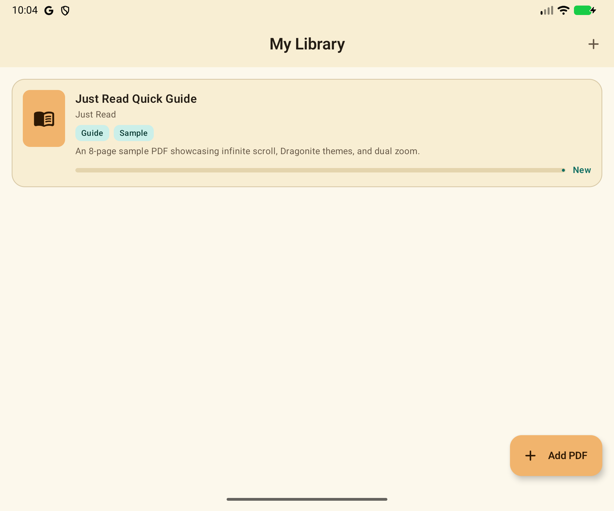
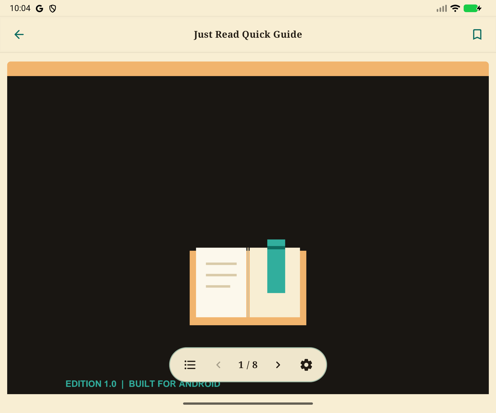
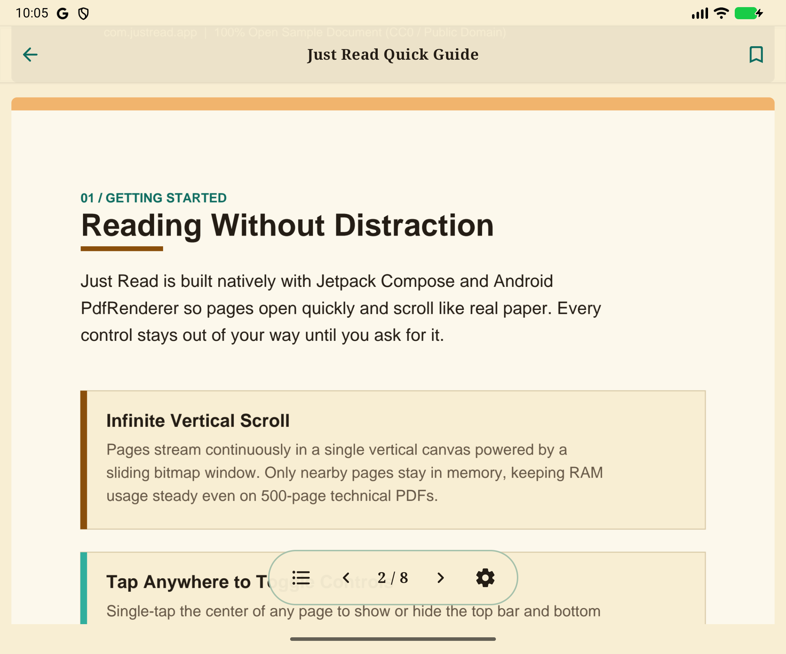

# Just Read

> A native Android PDF reading application ported from the original UWP [BookReaderApp](./archive/BookReaderApp/).

**[Download APK (v0.1.0-alpha.1)](https://github.com/Thees2k1/just-read/releases/download/v0.1.0-alpha.1/just-read.apk)** · **[All GitHub Releases](https://github.com/Thees2k1/just-read/releases)**

---

## Overview

**Just Read** aims to bring a clean, modern PDF reading experience to Android with:

- **Native Reading Experience** — Smooth Jetpack Compose UI with Material 3 theming (including system-synced dark/light mode) and responsive layouts across screen sizes.
- **Local Library & Search** — Fast local storage with full-text search, bookmarks, reading progress, and favorites.
- **Accessibility & Localization** — Built with Compose Semantics and multi-language support (`en`, `vi`).
- **Cloud & Open Resources *(Planned)*** — Optional open-library exploration (e.g., Internet Archive), cloud library sync, and AI-assisted features.

---

## Preview

Captured on **Pixel Fold (Android 17, Unfolded `2208×1840`)** running the signed `v0.1.0-alpha.1` release build *(dedicated multi-pane tablet/foldable layout planned next)*:

| Library | Reader Cover | Infinite Scroll & Dragonite Theme |
| :---: | :---: | :---: |
|  |  |  |

---

## Release Benchmarks (`v0.1.0-alpha.1`)

Measured on a physical **Samsung Galaxy A34 (`SM-A346E`, Android 14/15, 120Hz)** running the signed, R8-minified release build:

| Metric | Measured Value | Notes |
| :--- | :--- | :--- |
| **Signed Release APK Size** | **1.55 MB** | `isMinifyEnabled = true`, `isShrinkResources = true` (includes 8-page sample PDF) |
| **Cold Start (`TotalTime`)** | **484 – 639 ms** | Measured via `adb shell am start -W` |
| **Idle Memory (`TOTAL PSS`)** | **~31.3 MB** | Java Heap `2.7 MB` · Native Heap `10.2 MB` · Graphics `2.8 MB` |

---

## Tech Stack & Version Stack

| Component | Version / Value |
| :--- | :--- |
| **Application ID / Namespace** | `com.justread.app` |
| **Language & KGP** | Kotlin `2.3.20` (Coroutines, Flow) |
| **UI** | Jetpack Compose (BOM `2026.11.01`), Material 3 |
| **Android Gradle Plugin (AGP)** | `9.2.1` |
| **Gradle Wrapper** | `9.4.1-bin` |
| **Android SDK Targets** | `minSdk 24` \| `compileSdk 37` (`37.1`) \| `targetSdk 37` |
| **JVM Toolchain** | Java `17` (`jvmToolchain(17)`) |
| **Host JDK** | OpenJDK `25.0.3` (Android Studio JBR) |
| **Android Studio** | `2026.2.1` (Canary `2026.2.3`) |
| **Android CLI / ADB / Emulator** | `android` `1.1.16919734` \| ADB `36.0.0` \| Emulator `36.5.10.0` |

---

## Repository Structure

```text
just-read/
├── app/                 # Android application module (Kotlin + Jetpack Compose)
├── archive/
│   └── BookReaderApp/   # Original UWP reference implementation
├── gradle/              # Gradle wrapper & libs.versions.toml version catalog
├── notes/               # Development specs, roadmap, and engineering notes
├── .script/             # Environment diagnostics (android-doctor.ps1 / .sh)
├── AGENTS.md            # AI agent context, toolchain stack, and commands
└── README.md
```

---

## Getting Started

   ```
2. **Build the debug APK:**
   ```powershell
   .\gradlew.bat assembleDebug
   ```
3. **Run unit tests:**
   ```powershell
   .\gradlew.bat testDebugUnitTest
   ```
